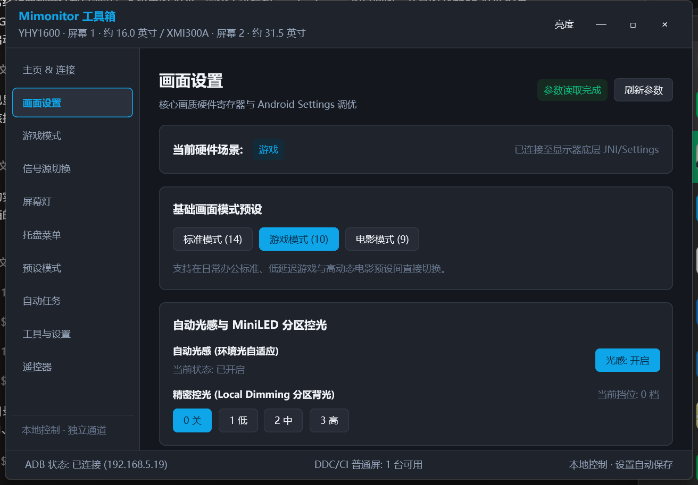
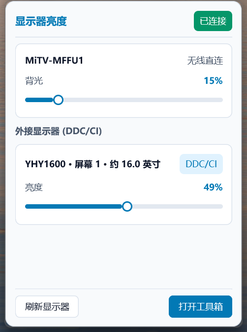

# Mimonitor 工具箱

**不用伸手找按键，坐在电脑前就能调显示器。**

在 Windows 桌面上集中管理小米 / Redmi 显示器，也能在同一面板分别调节其他外接屏的亮度。

[下载 EXE](https://github.com/ZGMFX01A/Mimonitor_Toolbox_ddc/releases) · [反馈问题](https://github.com/ZGMFX01A/Mimonitor_Toolbox_ddc/issues) · [功能一览](#能做什么)

## 为什么用它

白天办公想亮一点，晚上看电影想暗一点，打游戏又要换一套画面设置。每次伸手去按显示器按钮、逐层翻菜单，实在麻烦。

Mimonitor 工具箱尝试把这些日常操作收纳到桌面上：在系统托盘轻点即可调光，按下快捷键就能切换参数；调出满意的色彩后可存为预设，按设定时间自动切换；面对多屏工作台，也能在同一个调光面板内分别调节各屏幕亮度，省去来回抬手的麻烦。

## 能做什么

| 使用场景 | 工具箱提供的功能 |
| --- | --- |
| 快速调光 | 点击托盘图标展开统一亮度面板，分别调节小米屏背光与支持 DDC/CI 的普通外接屏亮度 |
| 画面精调 | 调节背光、对比度、饱和度、色温、RGB 增益、色域、精密控光及 HDR 色调映射等参数 |
| 场景预设 | 保存与快速应用画面预设；点击“编辑画面”调整当前预设，成功修改后自动同步写回 |
| 便捷操作 | 支持自定义快捷键（同一参数可设置多组快捷键）；托盘菜单提供常用参数切换与数值滑杆 |
| 定时切换 | 设置自动化任务，根据时间计划自动应用预设，并在任务结束时恢复进入任务前的画面设置 |
| 游戏辅助 | 控制 FreeSync、320Hz 模式、准星/动态准星、狙击辅助/夜视、FPS 帧率显示与计时器等 |
| 信号与屏幕灯 | 切换 HDMI、DP、Type-C 输入信号源；控制屏幕灯的运行模式、亮度、色温与颜色 |
| 设备维护 | 提供虚拟遥控器、ADB Guardian 保活守护检测与部署、设备重启、APK 安装及 ADB 终端 |

> **适用范围提示**：普通外接屏仅提供统一面板内的 DDC/CI 亮度调节；画面精调、游戏辅助、屏幕灯与设备维护等功能均基于设备专属 ADB 指令，仅面向支持对应指令的小米 / Redmi 显示器，实际可用项因设备型号和固件版本而异。

## 界面预览

上方展示了深色主题下的画面精调界面。日常调节亮度时，直接从托盘调出轻量面板即可：

  

界面支持浅色、深色以及跟随系统外观。以上截图均取自实际运行界面，显示的设备名称与具体可用选项会随当前连接的硬件自适应呈现。

## 开始使用

1. 从 [Releases](https://github.com/ZGMFX01A/Mimonitor_Toolbox_ddc/releases) 下载 `MimonitorToolbox.exe`，双击即可运行，无需安装或解压。
2. **连接小米 / Redmi 显示器**：
   - 确保显示器与电脑连接至同一局域网，且已在显示器的系统设置中开启“ADB 调试”。
   - 打开工具箱，在连接卡片中点击“扫描并连接”，或直接输入显示器的局域网 IP（通信端口固定为 `5555`）。
   - 若显示器屏幕弹出 ADB 调试授权确认框，请在屏幕上点击允许。
   - 扫描仅发现一台候选设备时会自动尝试连接；发现多台设备时，点击目标设备即可连接。工具箱会自动记录所用 IP，以便下次启动时尝试直连。
3. **控制普通外接屏**：
   - 在显示器自带的物理 OSD 菜单中确认已开启 DDC/CI 功能。
   - 点击主界面右上角或系统托盘的“亮度”图标打开调光面板即可开始使用，无需配置网络或 ADB。

只需下载一个 EXE，所需资源已内置，无需另装 Python、Node.js、Java 或 VC++ 运行库。第三方许可可在“工具与设置”中查看。

## 使用前了解这些

- **系统支持**：支持 64 位 Windows 10 / 11 系统。目前实机功能验证均在 Windows 11 环境下完成，Windows 10 尚未进行实机实测。
- **设备支持边界**：核心控制能力主要面向 Redmi G Pro 27U 等小米 / Redmi 系列显示器。支持 DDC/CI 的普通外接屏仅用于统一亮度调节，其兼容性可能受视频接口类型、转接线材及显卡驱动影响。
- **未知参数保护**：当设备未能成功返回某项参数的当前值时，工具箱将显示为“未知”并禁用依赖该参数的写入操作，避免使用默认值意外覆盖显示器的原有设定。
- **开机自启与重连**：可在“工具与设置”中开启开机自动启动，登录 Windows 后静默最小化至系统托盘，并尝试连接已保存的 IP。启动失败或掉线时会有限次退避重试，未授权时停止重试。再次双击程序会唤醒已有实例，不会重复占用 ADB 服务。
- **窗口退出行为**：支持配置关闭窗口时“最小化到托盘”或“直接退出”。设为最小化后，需右键托盘图标并选择“退出”方可完全关闭程序。
- **信号切换与维护**：切换显示输入源时画面会出现短暂中断；执行设备重启或分辨率调整等操作前，请先留意界面提示。

## 常见问题

**扫描不到小米 / Redmi 显示器怎么办？**

请先确认：① 显示器已开启 ADB 调试；② 电脑与显示器处于同一局域网（同一子网网段且无 AP 隔离限制）；③ 显示器 IP 输入正确。若扫描没有结果，可直接手动填入 IP 进行连接；首次连接时请留意显示器屏幕上的授权确认弹窗。启动时网络未就绪或连接中断后，会在有限次数内自动重试；若仍未恢复，请检查网络后点击“重新连接”。未授权时会停止重试，请先在显示器上确认授权。

**为什么普通外接屏不能调整色彩、色温或游戏辅助功能？**

本工具箱对普通外接屏仅提供 DDC/CI 亮度调节。画面、游戏和屏幕灯等功能通过小米 / Redmi 的设备专用 ADB 指令提供，是否可用取决于设备型号与固件。

**配置文件与日志存放在哪里？**

数据默认存放在 `%LOCALAPPDATA%\.mimonitor_toolbox_ddc\` 路径下。其中配置信息记录于 `config.json`，运行日志位于 `logs` 目录。首次检测到旧版配置时会先执行安全备份再行迁移；若备份未能成功，工具箱将以只读保护模式启动并弹出提示。

**遇到问题如何反馈？**

请前往 [GitHub Issues](https://github.com/ZGMFX01A/Mimonitor_Toolbox_ddc/issues) 提交反馈。为了便于快速定位问题，建议附上显示器具体型号、固件版本、视频连接线材与转接方式、复现操作步骤，以及 `logs` 目录下的相关日志内容。

---

[第三方许可与署名](THIRD_PARTY_NOTICES.md)

README 排版参考 [Best-README-Template](https://github.com/othneildrew/Best-README-Template)。
